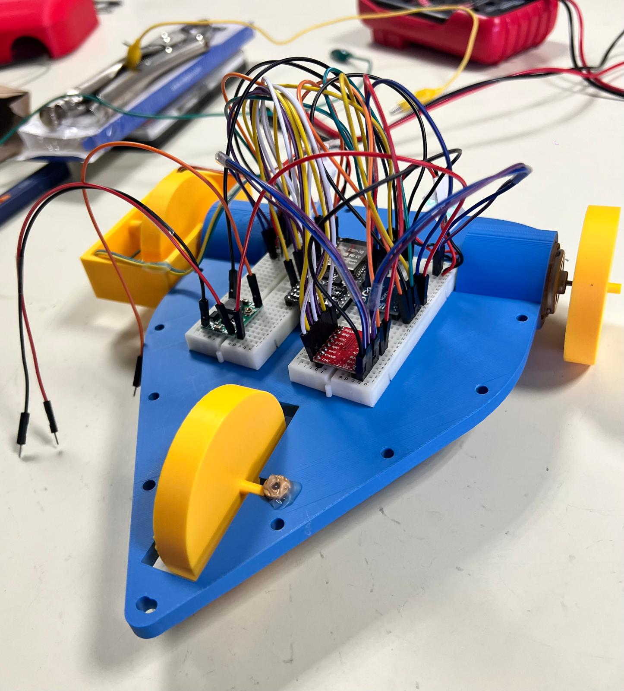

# Energy-Efficient Robotic Vehicle Control

**A real-world robotic platform for energy-aware control, reinforcement learning, and constrained optimization.**

> **Project status:** In development  
> The robotic hardware has been built, initial optimization algorithms have been explored, and the host-side control and data acquisition application is under development.
>
> 

## Overview

This project explores how to minimize the energy consumption of a miniature electric vehicle while completing a prescribed distance within a time constraint.

The platform combines:

- **Embedded systems:** ESP32-based control and sensor acquisition.
- **Robotics:** Two DC motors and spatially indexed motion control.
- **Energy measurement:** Real-time voltage and current monitoring.
- **Optimization:** Reinforcement learning, dynamic programming, and alternative control strategies.
- **Experimental software:** Remote control, data logging, and visualization.

The objective is to evaluate control strategies using measurements collected from a physical robotic vehicle.

## Optimization Objective

Minimize total electrical energy:

```math
\min_{\pi} E_{\mathrm{total}}
```

subject to:

```math
D = D_{\mathrm{target}}, \qquad T_{\mathrm{total}} \leq T_{\max}
```

where $\pi$ denotes the control policy, $D$ the traveled distance, and $T_{\mathrm{total}}$ the trajectory completion time.

## Hardware Platform

| Component                | Purpose                                  |
| ------------------------ | ---------------------------------------- |
| ESP32 NodeMCU-32S        | Embedded control and Wi-Fi communication |
| AS5600 magnetic encoder  | Wheel position measurement               |
| INA226 power monitor     | Voltage and current measurement          |
| TB6612FNG motor driver   | DC motor control                         |
| Two DC motors            | Vehicle propulsion                       |
| Battery and power system | Electrical energy supply                 |

**Note:** Integration and validation of the complete system remain in progress.
