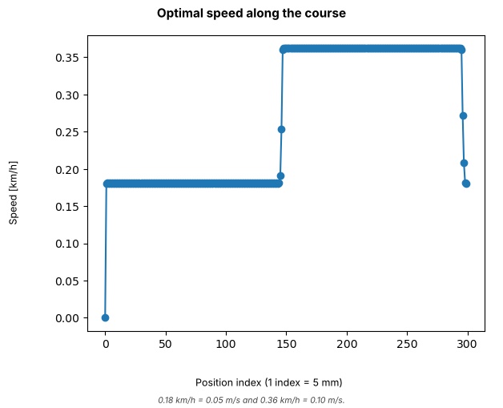
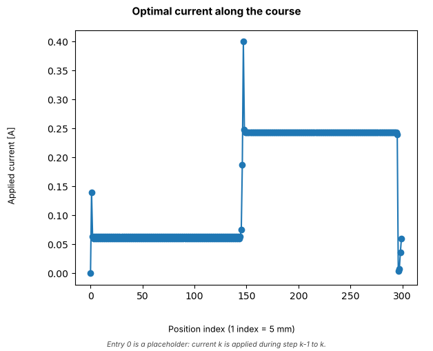
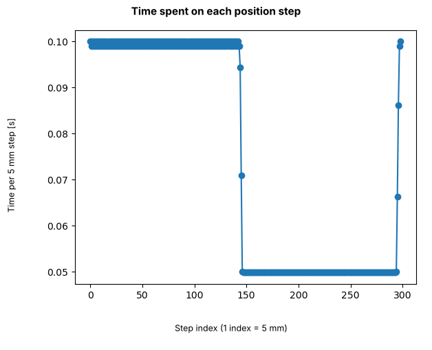
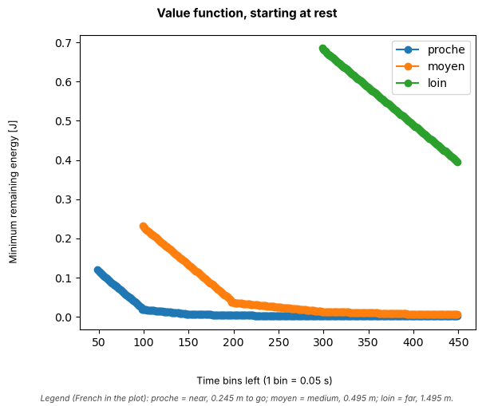
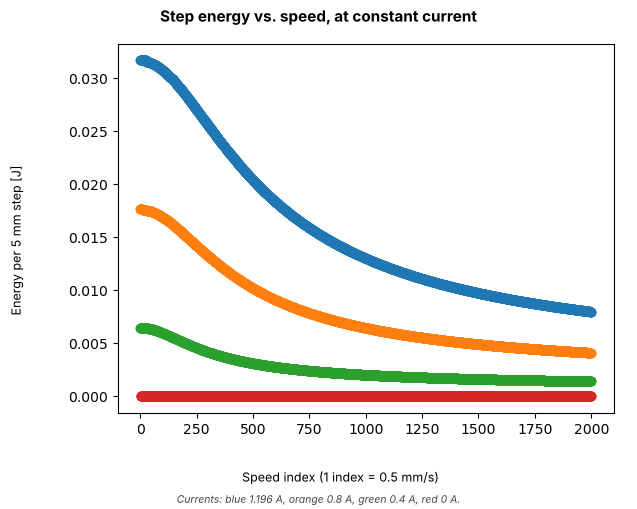
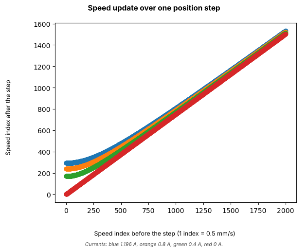

# Energy-optimal speed control by dynamic programming

Minimum-energy driving of a small electric vehicle over a fixed distance within a time budget, solved exactly on a grid with dynamic programming.

> **Status: simulation only.** The vehicle coefficients `K1`-`K4` are generic placeholders. They will be identified on the real vehicle, which is under construction. No result below has been validated on hardware.

**Notebook:** [`energy_optimal_speed_dp.ipynb`](energy_optimal_speed_dp.ipynb) (full run: about 20 minutes on an Apple M1, about 4 GiB of RAM). The figures below come from that run.

## Dynamic programming or reinforcement learning?

This is **dynamic programming** (backward induction on the Bellman equation, finite horizon). It is *model-based planning*: the vehicle model is known, so the optimum on the grid is computed exactly and nothing is learned from trial and error. **Model-free reinforcement learning** (for example ε-greedy Q-learning or deep RL) is the planned next step, once the model has been identified on hardware.

## Problem

Choose the motor current at every position step so that the vehicle covers 1.495 m (299 steps of 5 mm) within 22.5 s using as little electrical energy as possible, starting from rest. Decisions are triggered by position, not by a clock.

| | |
|---|---|
| **State** | speed, position, remaining time |
| **Action** | motor current |
| **Cost** | electrical energy [J] |
| **Constraint** | arrive before the time budget runs out |

The time constraint is enforced exactly by keeping the remaining time in the state, so no Lagrange multiplier is needed.

## Model

| Quantity | Formula |
|---|---|
| Speed after one step | `v' = sqrt(K1·v² + K2·i)` |
| Electrical power | `P = K3·v'·i + K4·i²` |
| Step duration | `Δt = Δx / v'` |
| Step energy | `E = P·Δx / v'` |

The step is assumed to be travelled at the speed reached at its end, `v'`. With `V = 0` at the goal and `V = +inf` when time runs out first, the Bellman recursion is

`V(v, x, t) = min over i of [ E(v, i) + V(v', x + Δx, t − Δt(v, i)) ]`

**Grid:** 2000 speeds (0 - 1 m/s, 0.5 mm/s steps) × 600 currents (0 - 2.4 A, 4 mA steps) × 300 positions (5 mm) × 450 time bins (0.05 s). The value table has 270 million entries; the policy table is the same size. A policy-iteration variant was tried earlier: under the time constraint it converged poorly and took roughly ten times longer (that comparison is not included in this folder).

## Results

### 1. The optimal profile has two speed levels

  
  

- **Speed.** The vehicle holds 0.18 km/h (0.05 m/s) for the first ~145 steps (about 0.73 m), switches over 2-3 steps near position index 147, then holds 0.36 km/h (0.10 m/s) for ~147 steps. Over the last 3-4 steps it slows back to about 0.18 km/h.
- **Current.** The two plateaus need about 0.06 A and 0.24 A. There is a short burst at the very first step (0.14 A, leaving rest) and a ramp up to a peak of 0.40 A to accelerate at the switch. The current falls to about 0 A over the last 2-3 steps: the vehicle coasts down, which fits the absence of a terminal-speed constraint in the model.
- **Holding currents match the model.** In steady state `v' = v` gives `i = (1 − K1)·v² / K2`, that is 0.060 A at 0.05 m/s and 0.241 A at 0.10 m/s, which are the plateaus observed.
- **Coasting matches the model.** At zero current the speed shrinks by `sqrt(K1) ≈ 0.75` per step. The end of the speed curve (0.36 → 0.27 → 0.21 km/h) follows that factor. With these placeholder coefficients, that is a very strong deceleration.

  

- **Time.** Each step takes 0.1 s on the slow plateau and 0.05 s on the fast one, so the course takes about 14.5 s + 7.4 s ≈ 22 s: nearly the whole 22.45 s budget is used. The time constraint is active, as expected, since going slower always saves energy. The thin double line on the slow plateau (0.099 s and 0.100 s) is grid rounding.

### 2. Value function: more time means less energy

  

Minimum remaining energy when starting at rest, for three distances to the goal (the plot legend is in French: *proche* = near, *moyen* = medium, *loin* = far).

- For the full course (1.495 m to go) the problem is feasible from 299 time bins (about 15 s), the fastest the grid allows (one bin per step). The minimum energy is **0.686 J** there and falls almost linearly to **0.396 J** at 449 bins (about 22.5 s): **42 % less** energy for 50 % more time.
- The shorter distances (0.245 m and 0.495 m) become feasible at about 50 and 100 bins, with about 0.12 J and 0.23 J (read from the figure).
- Their slope changes at about 100 and 200 bins, which is twice their first feasible time, then flattens close to zero. This is consistent with two step durations being available: once every step can take two bins, extra time only allows slower, cheaper steps.

### 3. The model tables

  
  

- **Step energy (left).** At constant current, a faster step costs less energy, because less time is spent in the `i²` loss term. Higher currents cost more at every speed, and zero current costs nothing (red line on the axis).
- **Speed update (right).** At zero current the speed shrinks with slope `sqrt(K1) ≈ 0.75`. Adding current lifts the curve: from standstill, 1.196 A reaches about 0.15 m/s (`sqrt(K2·i)`).

### 4. Sanity check

A back-of-the-envelope estimate from the step-energy table (energy of the steady-state step at 0.10 m/s and 0.05 m/s, times 299 steps) reproduces the DP values within 4 %.

| Scenario | Estimate | DP result |
|---|---|---|
| All steps fast (about 299 bins) | 0.663 J | 0.686 J |
| Half fast, half slow (about 449 bins) | 0.382 J | 0.396 J |

The remaining 3-4 % is plausibly the start-up, the switch and the end transients.

## Limitations: how to read these results

1. **The two-level profile is probably a grid effect.** In steady state the energy per metre is about `9.6·v² + 348·v³` J/m. As a function of the time per metre this is convex, so with continuous time the optimum would be a constant speed of about 0.067 m/s, costing roughly **0.22 J** (steady-state estimate, 0.218 J by formula and 0.222 J from the table). That speed is not representable on the 0.05 s time grid: every step is rounded up to a whole number of bins, so 0.075 s counts as 0.1 s and 299 such steps would need 598 bins instead of the 449 available. The DP then time-shares between one-bin and two-bin steps, which gives the two plateaus and an optimum (0.396 J) that is about 80 % above the continuous estimate. This is an interpretation based on the tables, not a run: the test is to refine `D_TIME`.
2. **Speed cap in time accounting.** Each step costs at least one time bin, so no step is credited as faster than `Δx / Δt = 0.1 m/s`, and the fast plateau sits exactly on that cap.
3. **Placeholder coefficients.** `K1`-`K4` are generic. With them, zero current removes 25 % of the speed per 5 mm step, which looks much stronger than expected for a real vehicle.
4. **No hardware validation yet**, and no terminal-speed constraint (the vehicle need not stop at the goal).
5. **Memory.** The tables take about 4 GiB; refining `D_TIME` multiplies this accordingly.

## Next steps

- Build the electronics and onboard control, and identify `K1`-`K4` on the real vehicle.
- Refine the time grid, or relax the time constraint with a Lagrange multiplier, and compare with the current result.
- Replace the known model by a model-free RL agent (ε-greedy, then deep RL) and compare with the dynamic-programming optimum.

## Files

| File | Content |
|---|---|
| `energy_optimal_speed_dp.ipynb` | Model, dynamic programming and trajectory extraction |
| `images/` | Figures from the full run. Titles and axis labels were added around the original plots; the plotted data are unchanged |

**Run:** Python 3 with `numpy` and `matplotlib`, then open the notebook (`Restart & Run All`, about 20 minutes and 4 GiB of RAM).
